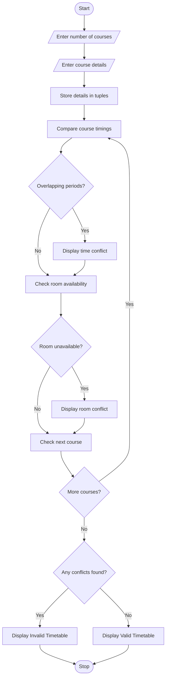

## 1. Problem Statement

Write a Python program using strings and tuples to validate student timetables. Compare course schedules, detect overlapping class periods, identify unavailable rooms, and check whether the proposed timetable is valid.

Rules:

- Two courses cannot overlap on the same day.
- Two courses cannot use the same room at the same time.
- Unavailable rooms cannot be assigned to classes.

## 2. Algorithm

1. Start the program.
2. Enter the number of courses.
3. Enter course name, day, start time, end time and room number.
4. Store the details using tuples.
5. Compare course schedules to detect overlapping periods.
6. Check whether the assigned room is unavailable.
7. Display detected conflicts.
8. Display the timetable validation result.
9. Stop the program.

## 3. Flowchart 


## 4. Sample Input

```
Enter number of courses: 3

Course 1
Course name: Python
Day: Monday
Start time (HH:MM): 09:00
End time (HH:MM): 10:00
Room number: R1

Course 2
Course name: Mathematics
Day: Monday
Start time (HH:MM): 09:30
End time (HH:MM): 11:00
Room number: R2

Course 3
Course name: English
Day: Tuesday
Start time (HH:MM): 10:00
End time (HH:MM): 11:00
Room number: R3
```

## 5. Sample Output

```
Time conflict: Python and Mathematics
Room unavailable for: Mathematics

Timetable is Invalid!
```
