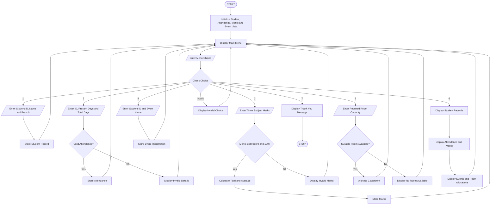

## 1. Problem Statement

Develop a menu-driven Python program to simulate a Smart Campus Management System that integrates student records, attendance management, marks calculation, event registration, and classroom resource allocation.

The program should allow users to add and display student details, record attendance, enter and calculate student marks, register students for campus events, and allocate classrooms based on available capacity.

The program should use conditional statements, loops, strings, lists, nested lists, tuples, and tuple unpacking. Finally, generate a summary report displaying student information, attendance percentage, marks, event registrations, and resource allocation details.

## 2. Algorithm

1. Start the program.
2. Create empty lists to store student records, attendance, marks, and event registrations.
3. Create tuples to store classroom names and their capacities.
4. Display the main menu.
5. Ask the user to select an option.
6. Perform the selected operation:
   - Add Student: Enter student ID, name, and branch. Store the details in a list.
   - Attendance: Enter student ID and attendance status. Store attendance records.
   - Marks: Enter marks for three subjects and calculate total and average.
   - Event Registration: Enter student ID and event name. Store registration details.
   - Resource Allocation: Display classrooms and capacities. Allocate a classroom based on the number of students.
   - Summary Report: Display student records, attendance, marks, event registrations, and classroom allocation.
7. Use conditional statements to validate menu choices and student details.
8. Repeat the menu using a loop until the user selects Exit.
9. Display the final message.
10. Stop the program.


## 3. Flowchart 



## 4. Sample Input

```
===== SMART CAMPUS MANAGEMENT =====
1. Add Student
2. Record Attendance
3. Enter Student Marks
4. Event Registration
5. Resource Allocation
6. Summary Report
7. Exit

Enter your choice: 1
Enter Student ID: 101
Enter Student Name: Anu
Enter Branch: CSE

Enter your choice: 2
Enter Student ID: 101
Enter Present Days: 18
Enter Total Working Days: 20

Enter your choice: 3
Enter Student ID: 101
Enter Subject 1 Marks: 85
Enter Subject 2 Marks: 90
Enter Subject 3 Marks: 80

Enter your choice: 4
Enter Student ID: 101
Enter Event Name: Tech Fest

Enter your choice: 5
Enter Required Room Capacity: 35

Enter your choice: 6

Enter your choice: 7
```

## 5. Sample Output

```
===== SMART CAMPUS MANAGEMENT =====

Student added successfully!

Attendance recorded!

Total: 255 Average: 85.0

Event registration successful!

Allocated Room: A101

===== CAMPUS SUMMARY REPORT =====

Student Records:
101 Anu CSE

Attendance Details:
101 18 / 20 Percentage: 90.0 %

Marks Details:
[101, 85, 90, 80, 255, 85.0]

Event Registrations:
101 Tech Fest

Resource Allocations:
A101 Capacity Used: 35

Thank you for using Smart Campus Management!
```

