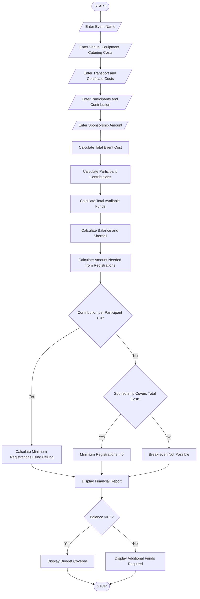

## 1. Problem Statement

Develop a Python program to calculate and manage the financial planning of a college campus event. The program should calculate different expenses, including venue charges, equipment costs, catering expenses, transportation costs, and certificate costs.

The program should accept the number of participants, contribution amount per participant, and sponsorship amount. It should calculate the total event expenditure, total participant contributions, sponsorship amount, any remaining financial shortfall, and the minimum number of registrations required to break even.

The program should use variables, arithmetic operators, conditional statements, and basic input/output statements to generate a financial summary report.

## 2. Algorithm

1. Start the program.
2. Input the event name.
3. Input the venue cost.
4. Input equipment cost.
5. Input catering cost.
6. Input transportation cost.
7. Input certificate cost.
8. Input the number of participants.
9. Input contribution amount per participant.
10. Input sponsorship amount.
11. Calculate total event expenditure.

&#x20;  Total Cost = Venue + Equipment + Catering + Transport + Certificates

12\. Calculate participant contributions.

&#x20;  Contributions = Participants × Contribution per Participant

13\. Calculate total available funds.

&#x20;  Total Funds = Contributions + Sponsorship

14\. Calculate financial balance.

&#x20;  Balance = Total Funds − Total Cost

15. If the balance is negative, calculate the sponsorship shortfall.
16. Calculate minimum registrations required to break even.

&#x20;  Minimum Registrations = (Total Cost − Sponsorship) / Contribution per Participant, rounded up to the next whole number.

17. Display the complete financial report.
18. Stop the program.


## 3. Flowchart 



## 4. Sample Input

```
Enter Event Name: Tech Fest

Enter Venue Cost: 10000
Enter Equipment Cost: 5000
Enter Catering Cost: 15000
Enter Transport Cost: 5000
Enter Certificate Cost: 2000

Enter Number of Participants: 100
Enter Contribution per Participant: 300
Enter Sponsorship Amount: 10000
```

## 5. Sample Output

```
===== CAMPUS EVENT FINANCIAL REPORT =====
Event Name: Tech Fest
-----------------------------------------
Venue Cost       : Rs. 10000.0
Equipment Cost   : Rs. 5000.0
Catering Cost    : Rs. 15000.0
Transport Cost   : Rs. 5000.0
Certificate Cost : Rs. 2000.0
-----------------------------------------
Total Cost       : Rs. 37000.0
Participant Fund : Rs. 30000.0
Sponsorship      : Rs. 10000.0
Total Funds      : Rs. 40000.0
Financial Balance: Rs. 3000.0
Sponsorship Shortfall: Rs. 0
Minimum Registrations: 90
Event Status: Budget Covered
=========================================
```

