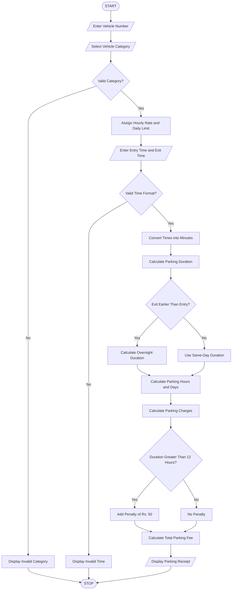

## 1. Problem Statement

Develop a Python program to manage a Smart Parking Fee Management System. The program should calculate parking charges based on vehicle entry time, exit time, and vehicle category such as two-wheelers, cars, and buses.

The system should calculate parking duration, including overnight parking, apply different hourly rates for different vehicle categories, and enforce daily maximum parking limits. It should also identify penalty conditions for invalid time entries and calculate additional penalty charges when the parking duration exceeds the permitted limit.

Finally, the program should generate a formatted parking receipt displaying vehicle details, parking duration, hourly charges, penalties, and total parking fees.

## 2. Algorithm

1. Start the program.
2. Input vehicle number.
3. Input vehicle category.
4. Input entry time in HH:MM format.
5. Input exit time in HH:MM format.
6. Validate the entered time format.
7. Convert entry and exit times into minutes.
8. If exit time is earlier than entry time, consider overnight parking.
9. Calculate total parking duration.
10. Calculate parking hours using ceiling division.
11. Assign hourly rates:
    - Two-wheeler – ₹10 per hour.
    - Car – ₹20 per hour.
    - Bus – ₹40 per hour.
12. Calculate parking charges.
13. Apply a daily maximum limit:
    - Two-wheeler – ₹100.
    - Car – ₹200.
    - Bus – ₹400.
14. If parking exceeds 24 hours, calculate additional daily charges.
15. Apply a penalty of ₹50 if parking exceeds 12 hours.
16. Calculate the final parking fee.
17. Display the parking receipt.
18. Stop the program.

## 3. Flowchart 


## 4. Sample Input

```
Enter Vehicle Number: AP39AB1234

1. Two-Wheeler
2. Car
3. Bus

Select Vehicle Category: 2

Enter Entry Time (HH:MM): 09:00
Enter Exit Time (HH:MM): 15:00
```

## 5. Sample Output

```
===== PARKING RECEIPT =====
Vehicle Number: AP39AB1234
Vehicle Category: Car
Entry Time: 09:00
Exit Time: 15:00
Parking Duration: 6 hours
Parking Charge: Rs. 120
Penalty: Rs. 0
Total Fee: Rs. 120
===========================
```
