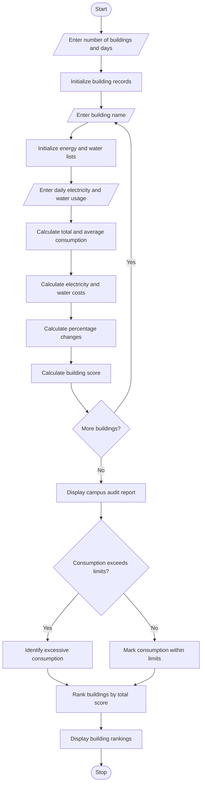

## 1. Problem Statement

Develop a Python program to analyse electricity and water consumption across different campus buildings over multiple days. The program should calculate the total energy and water consumption, determine their costs using fixed rates, calculate percentage changes in consumption, identify buildings with excessive usage, and rank buildings using a scoring method.

The scoring method is:

- Energy score = Electricity consumption × 0.6
- Water score = Water consumption × 0.4
- Total score = Energy score + Water score
- Buildings are ranked in descending order of total score.

The program should also identify buildings whose average daily consumption exceeds the specified limits.

## 2. Algorithm

1. Start the program.
2. Read the number of buildings and number of days.
3. Enter the building names.
4. Enter daily electricity and water consumption for each building.
5. Calculate total and average electricity consumption.
6. Calculate total and average water consumption.
7. Calculate electricity and water costs using fixed rates.
8. Calculate percentage changes between the first and last day.
9. Identify buildings exceeding energy and water consumption limits.
10. Calculate the total score for each building.
11. Rank buildings according to their scores.
12. Display the audit report.
13. Stop the program.


## 3. Flowchart



## 4. Sample Input

```
Enter number of buildings: 3
Enter number of days: 3

Enter building name: Academic
Day 1
Enter electricity consumption (kWh): 120
Enter water consumption (litres): 400
Day 2
Enter electricity consumption (kWh): 130
Enter water consumption (litres): 420
Day 3
Enter electricity consumption (kWh): 140
Enter water consumption (litres): 450

Enter building name: Library
Day 1
Enter electricity consumption (kWh): 80
Enter water consumption (litres): 300
Day 2
Enter electricity consumption (kWh): 90
Enter water consumption (litres): 320
Day 3
Enter electricity consumption (kWh): 100
Enter water consumption (litres): 350

Enter building name: Hostel
Day 1
Enter electricity consumption (kWh): 150
Enter water consumption (litres): 600
Day 2
Enter electricity consumption (kWh): 160
Enter water consumption (litres): 650
Day 3
Enter electricity consumption (kWh): 180
Enter water consumption (litres): 700
```

## 5. Sample Output

```
========== CAMPUS AUDIT REPORT ==========

Building: Academic
Total Electricity: 390.0 kWh
Total Water: 1270.0 litres
Average Electricity: 130.0
Average Water: 423.33
Electricity Cost: Rs. 3120.0
Water Cost: Rs. 2540.0
Total Cost: Rs. 5660.0
Electricity Change: 16.67 %
Water Change: 12.5 %
Excessive Electricity Consumption

Building: Library
Total Electricity: 270.0 kWh
Total Water: 970.0 litres
Average Electricity: 90.0
Average Water: 323.33
Electricity Cost: Rs. 2160.0
Water Cost: Rs. 1940.0
Total Cost: Rs. 4100.0
Electricity Change: 25.0 %
Water Change: 16.67 %
Consumption is within limits

Building: Hostel
Total Electricity: 490.0 kWh
Total Water: 1950.0 litres
Average Electricity: 163.33
Average Water: 650.0
Electricity Cost: Rs. 3920.0
Water Cost: Rs. 3900.0
Total Cost: Rs. 7820.0
Electricity Change: 20.0 %
Water Change: 16.67 %
Excessive Electricity Consumption
Excessive Water Consumption

========== BUILDING RANKING ==========

1 Academic - Score: 2380.0
2 Hostel - Score: 1074.0
3 Library - Score: 550.0

Audit Completed Successfully!
```
