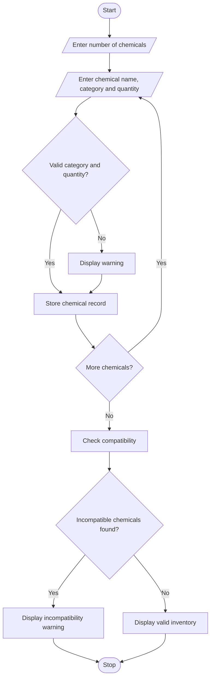

## 1. Problem Statement

Write a Python program to validate hypothetical laboratory chemical inventory records. Check whether each chemical has a valid storage category, whether its quantity exceeds the maximum allowed quantity, and whether incompatible chemicals are stored together. Display invalid records with suitable warning messages.

Assumed rules:

- Acid and Base cannot be stored together.
- Flammable and Oxidizer cannot be stored together.
- Maximum quantity for each category is 50 litres.

## 2. Algorithm

1. Start the program.
2. Enter the number of chemical records.
3. Enter chemical name, category and quantity.
4. Check the storage category.
5. Check whether quantity exceeds 50 litres.
6. Check compatibility restrictions.
7. Display warnings for invalid records.
8. Display the validation result.
9. Stop.


## 3. Flowchart 


## 4. Sample Input

```
Enter number of chemicals: 3

Chemical name: Hydrochloric Acid
Category: Acid
Quantity in litres: 20

Chemical name: Sodium Hydroxide
Category: Base
Quantity in litres: 30

Chemical name: Ethanol
Category: Flammable
Quantity in litres: 60
```

## 5. Sample Output

```
Invalid quantity!
Incompatible: Hydrochloric Acid and Sodium Hydroxide

Inventory contains invalid records!
```

