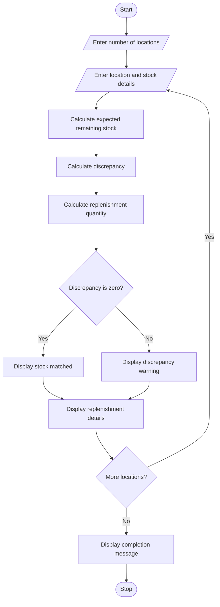

# Food Supply Chain Stock Reconciliation

## 1. Problem Statement

Write a Python program to compare food quantities received, distributed, damaged and remaining across different locations. Calculate the expected remaining stock, identify stock discrepancies and determine the quantity required for replenishment.

## 2. Algorithm

1. Start the program.
2. Enter the number of locations.
3. Enter the location name.
4. Enter received, distributed, damaged and actual remaining quantities.
5. Calculate expected remaining stock.
6. Compare expected stock with actual stock.
7. Identify stock discrepancies.
8. Calculate replenishment quantity using the minimum stock level.
9. Display the stock report.
10. Stop the program.

## 3. Flowchart 

## 4. Sample Input

```
Enter number of locations: 2

Location 1
Enter location name: College Canteen
Quantity received: 100
Quantity distributed: 60
Quantity damaged: 5
Actual remaining stock: 35

Location 2
Enter location name: Hostel
Quantity received: 150
Quantity distributed: 100
Quantity damaged: 10
Actual remaining stock: 30
```

## 5. Sample Output

```
--- Stock Report ---
Location: College Canteen
Expected Stock: 35
Actual Stock: 35
Discrepancy: 0
Replenishment Required: 0
Stock Status: Matched

--- Stock Report ---
Location: Hostel
Expected Stock: 40
Actual Stock: 30
Discrepancy: -10
Replenishment Required: 0
Stock Status: Discrepancy Found

Stock Reconciliation Completed!
```
