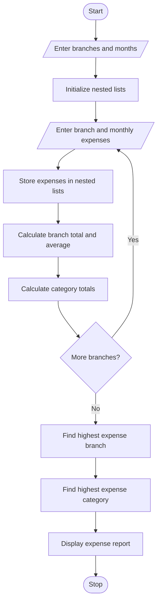

## 1. Problem Statement

Write a Python program using nested lists to analyse monthly expenses across multiple branches and expense categories. Calculate the total and average expenses for each branch, find category-wise expenditure, and identify the largest contributors to total expenditure.

## 2. Algorithm

1. Start the program.
2. Enter the number of branches, months and expense categories.
3. Enter branch names and category names.
4. Store monthly expenses using nested lists.
5. Calculate total expenses for each branch.
6. Calculate average monthly expenses.
7. Calculate category-wise total expenses.
8. Identify the branch and category with the highest expenditure.
9. Display the expense report.
10. Stop the program.

## 3. Flowchart 



## 4. Sample Input

```
Enter number of branches: 2
Enter number of months: 2

Branch 1
Enter branch name: Vijayawada
Month 1
Rent expense: 10000
Salary expense: 20000
Electricity expense: 3000

Month 2
Rent expense: 11000
Salary expense: 20000
Electricity expense: 3500

Branch 2
Enter branch name: Guntur
Month 1
Rent expense: 9000
Salary expense: 18000
Electricity expense: 2500

Month 2
Rent expense: 9000
Salary expense: 18000
Electricity expense: 3000
```

## 5. Sample Output

```
Vijayawada Total: 67500.0
Average: 33750.0

Guntur Total: 59500.0
Average: 29750.0

Category-wise Expenses:
Rent : 39000.0
Salary : 76000.0
Electricity : 12000.0

Highest Expense Branch: Vijayawada
Highest Expense Category: Salary
Overall Expense: 127000.0
```
